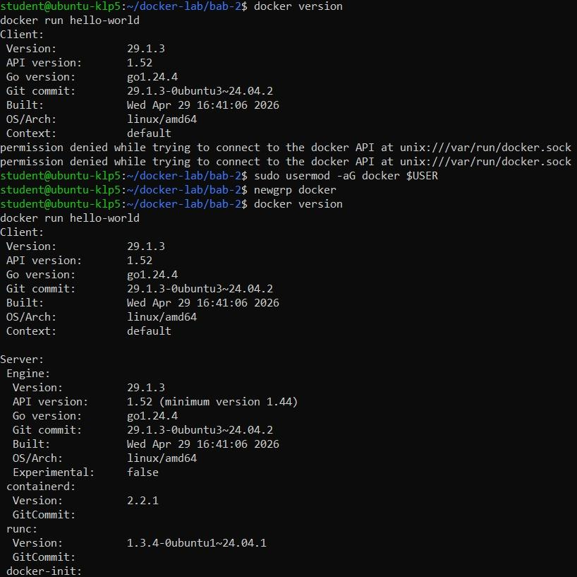

# Praktikum 01: Fondasi Teoritis dan Kerangka Kerja DevSecOps

> **Mata Kuliah:** Workshop DevOps  
> **Dosen Pengampu:** Dr. Ferry Astika Saputra, S.T., M.Sc.  
> **Kelompok:** 5  
> **Anggota:**
> - Muhammad Fajrul Fatih Abul ‘Ilmi (3124600040)
> - Nur Aini Agusthina (3124600050)
> - Abdullah Falich (3124600059)
> 
> **Program Studi:** D4 Teknik Informatika, Departemen Teknik Informatika dan Komputer  
> **Institusi:** Politeknik Elektronika Negeri Surabaya (PENS) - 2026

---

## PRAKTIKUM BAB 1: FONDASI TEORITIS DAN KERANGKA KERJA DEVSECOPS

### Praktikum

#### Menetapkan Baseline Laboratorium

```bash
mkdir -p ~/devsecops-lab/{app,policy,reports,sbom,keys}
cd ~/devsecops-lab
docker version
docker compose version
git --version
openssl version
curl --version
```



```bash
docker info --format '{{json .SecurityOptions}}'

```

