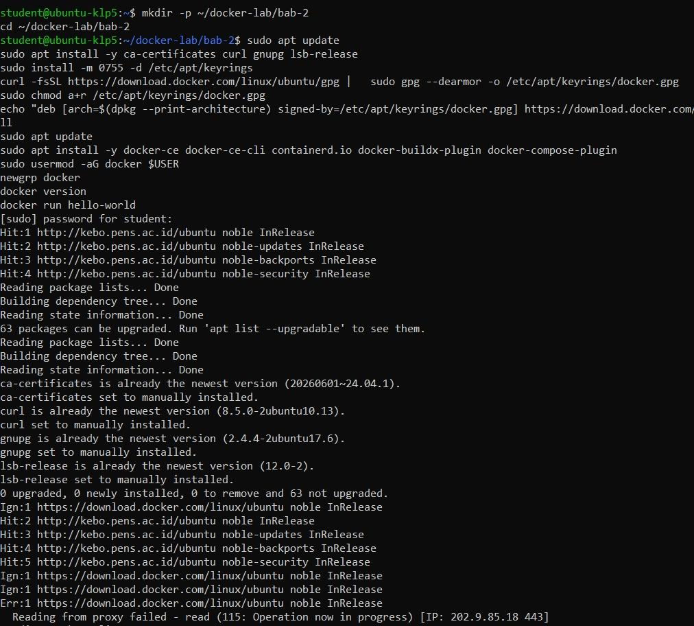
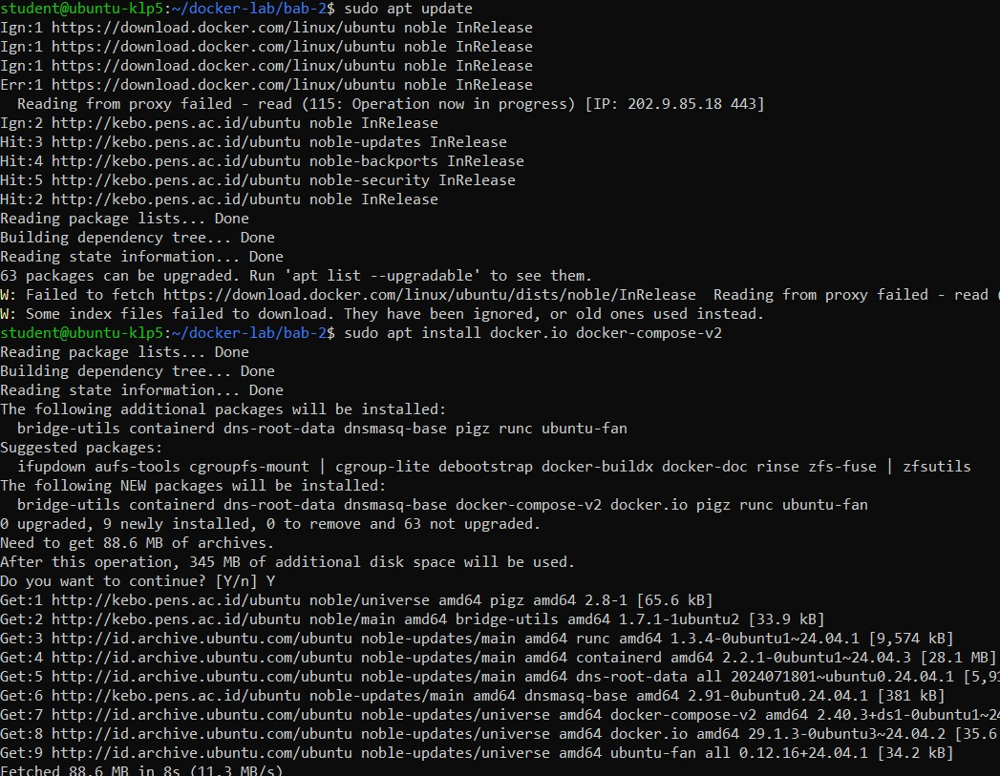
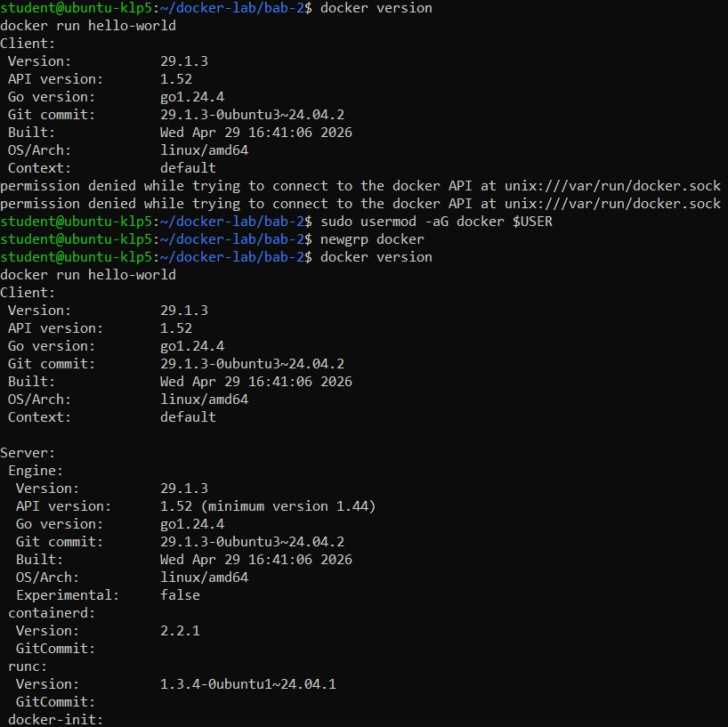
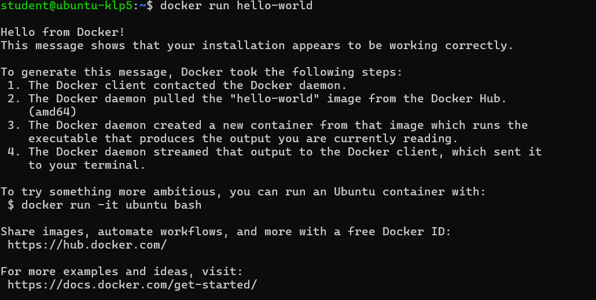
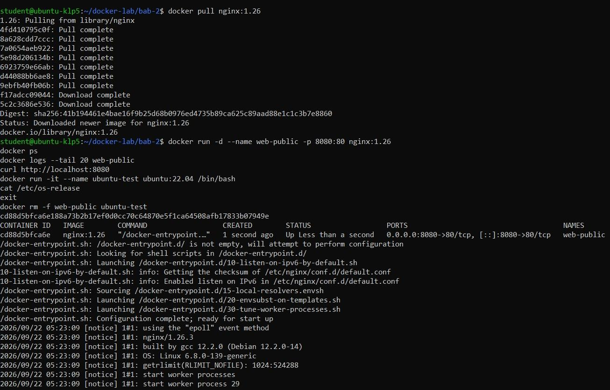
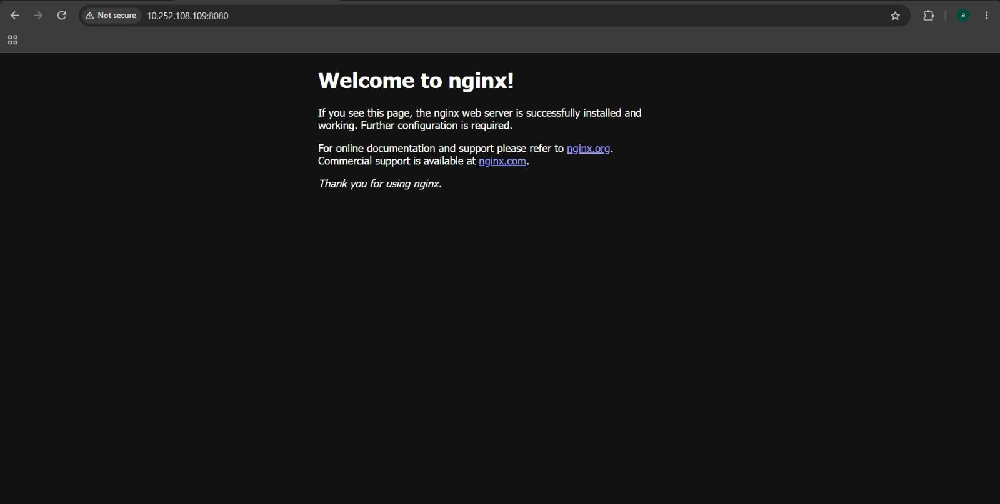
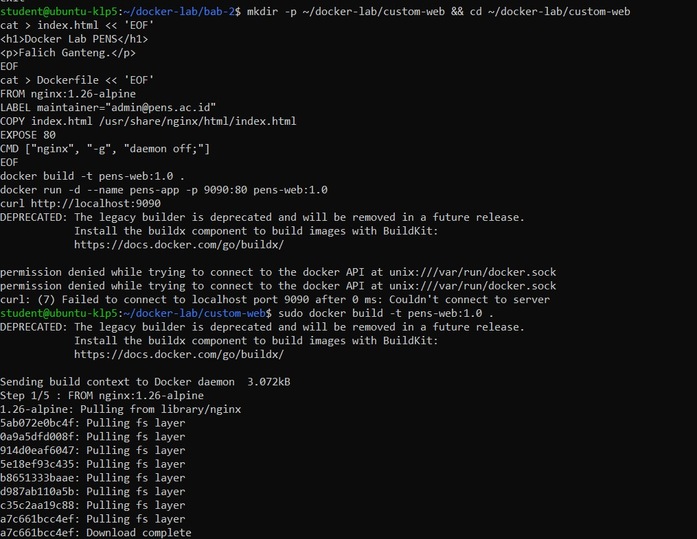
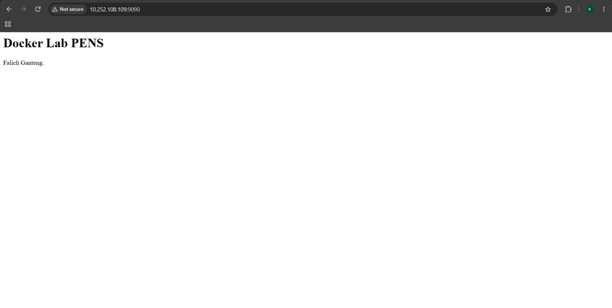

# Praktikum 02: Konsep Container dan Instalasi Docker

> **Mata Kuliah:** Workshop DevOps  
> **Dosen Pengampu:** Dr. Ferry Astika Saputra, S.T., M.Sc.  
> **Kelompok:** 5  
> **Anggota:**
> - Muhammad Fajrul Fatih Abul ‘Ilmi (3124600040)
> - Nur Aini Agusthina (3124600050)
> - Abdullah Falich (3124600059)
> 
> **Program Studi:** D4 Teknik Informatika, Departemen Teknik Informatika dan Komputer  
> **Institusi:** Politeknik Elektronika Negeri Surabaya (PENS) - 2026

---

## PRAKTIKUM BAB 2: KONSEP CONTAINER DAN INSTALASI DOCKER

### Praktikum

#### Arsitektur Laboratorium dan Prasyarat Lingkungan

```bash
mkdir -p ~/docker-lab/bab-2
cd ~/docker-lab/bab-2
sudo apt update
```





```bash
sudo usermod -aG docker $USER
newgrp docker
docker version
```



```bash
docker run hello-world 
```



#### Container Nginx dan Ubuntu Interaktif

```bash
docker pull nginx:1.26
docker run -d --name web-public -p 8080:80 nginx:1.26
```



```bash
docker logs --tail 20 web-public
curl http://localhost:8080
```



#### Dockerfile Custom Web Statis

```dockerfile
mkdir -p ~/docker-lab/custom-web && cd ~/docker-lab/custom-web
cat > index.html << 'EOF'
<h1>Docker Lab PENS</h1>
<p>Container berhasil berjalan.</p>
EOF
cat > Dockerfile << 'EOF'
FROM nginx:1.26-alpine
LABEL maintainer="admin@pens.ac.id"
COPY index.html /usr/share/nginx/html/index.html
EXPOSE 80
CMD ["nginx", "-g", "daemon off;"]
EOF
docker build -t pens-web:1.0 .
docker run -d --name pens-app -p 9090:80 pens-web:1.0
```



```dockerfile
curl http://localhost:9090
```



