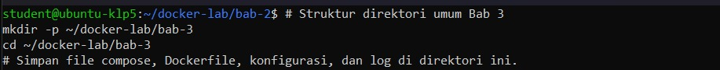
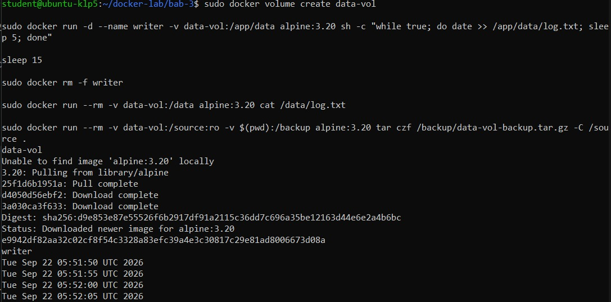
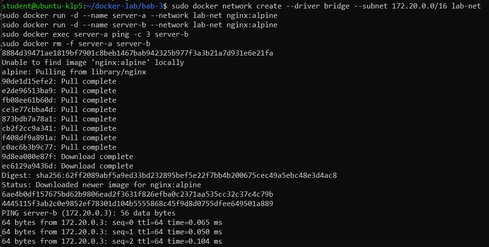
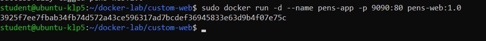
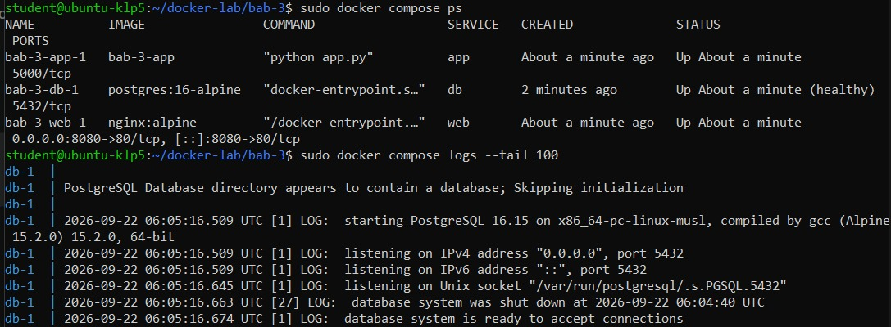
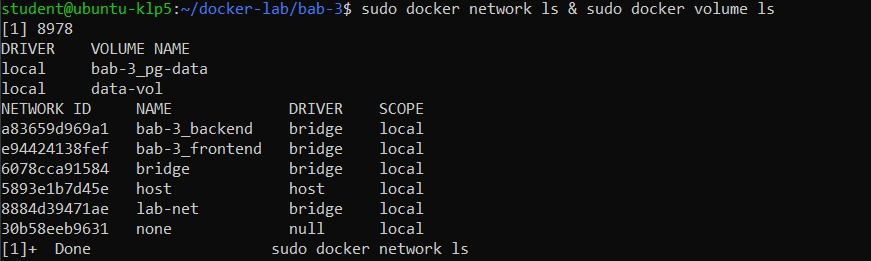
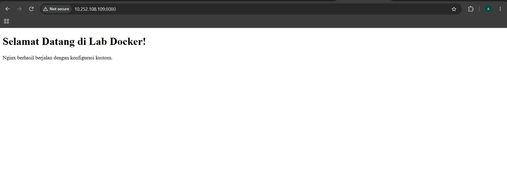

# Praktikum 03: Docker Network, Volume, Bind Mount, Tmpfs, dan Compose

> **Mata Kuliah:** Workshop DevOps  
> **Dosen Pengampu:** Dr. Ferry Astika Saputra, S.T., M.Sc.  
> **Kelompok:** 5  
> **Anggota:**
> - Muhammad Fajrul Fatih Abul ‘Ilmi (3124600040)
> - Nur Aini Agusthina (3124600050)
> - Abdullah Falich (3124600059)
> 
> **Program Studi:** D4 Teknik Informatika, Departemen Teknik Informatika dan Komputer  
> **Institusi:** Politeknik Elektronika Negeri Surabaya (PENS) - 2026

---

## PRAKTIKUM BAB 3: DOCKER NETWORK, VOLUME, BIND MOUNT, TMPFS, DAN COMPOSE

### Praktikum

#### Arsitektur Laboratorium dan Prasyarat Lingkungan

```bash
# Struktur direktori umum Bab 3
mkdir -p ~/docker-lab/bab-3
cd ~/docker-lab/bab-3
# Simpan file compose, Dockerfile, konfigurasi, dan log di direktori ini.
```



#### User-defined Bridge Network

```bash
docker volume create data-vol
docker run -d --name writer -v data-vol:/app/data alpine:3.20   sh -c "while true; do date >> /app/data/log.txt; sleep 5; done"
sleep 15
docker rm -f writer
docker run --rm -v data-vol:/data alpine:3.20 cat /data/log.txt
```













