# Praktikum 04: Web Service Container (Nginx, Apache, TLS, Flask App)

> **Mata Kuliah:** Workshop DevOps  
> **Dosen Pengampu:** Dr. Ferry Astika Saputra, S.T., M.Sc.  
> **Kelompok:** 5  
> **Anggota:**
> - Muhammad Fajrul Fatih Abul ‘Ilmi (3124600040)
> - Nur Aini Agusthina (3124600050)
> - Abdullah Falich (3124600059)
> 
> **Program Studi:** D4 Teknik Informatika, Departemen Teknik Informatika dan Komputer  
> **Institusi:** Politeknik Elektronika Negeri Surabaya (PENS) - 2026

---

## PRAKTIKUM

### Direktori Kerja

```bash
mkdir -p ~/docker-lab/bab-4/{apache/sites,nginx/conf,certs,logs/nginx,app}
cd ~/docker-lab/bab-4
```

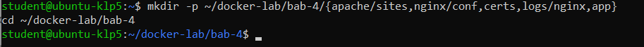

Struktur file:

```text
bab-4/
├── compose.yaml
├── nginx/conf/default.conf
├── apache/sites/index.html
├── app/Dockerfile
├── app/requirements.txt
├── app/app.py
├── certs/lab.crt
├── certs/lab.key
└── logs/nginx/

```

### Sertifikat TLS Laboratorium

```bash
openssl req -x509 -nodes -days 365 -newkey rsa:2048 \
  -keyout certs/lab.key \
  -out certs/lab.crt \
  -subj "/CN=localhost/O=DevSecOps Docker Lab" \
  -addext "subjectAltName=DNS:localhost,IP:127.0.0.1"

chmod 600 certs/lab.key
chmod 644 certs/lab.crt
```

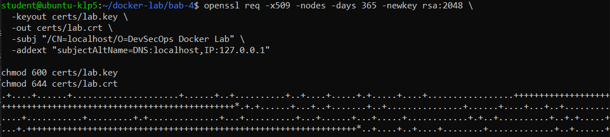

### File compose.yaml

```yaml
nano compose.yaml

services:
  proxy:
    image: nginx:alpine
    ports:
      - "127.0.0.1:8080:80"
      - "127.0.0.1:8443:443"
    volumes:
      - ./nginx/conf:/etc/nginx/conf.d:ro
      - ./certs:/etc/nginx/certs:ro
      - ./logs/nginx:/var/log/nginx
    networks:
      - web-net
    depends_on:
      apache-web:
        condition: service_started
      flask-app:
        condition: service_healthy

  apache-web:
    image: httpd:2.4-alpine
    volumes:
      - ./apache/sites:/usr/local/apache2/htdocs:ro
    networks:
      - web-net

  flask-app:
    build:
      context: ./app
    networks:
      - web-net
    healthcheck:
      test:
        - CMD
        - python
        - -c
        - "import urllib.request; urllib.request.urlopen('http://127.0.0.1:5000/health')"
      interval: 5s
      timeout: 3s
      retries: 5
      start_period: 5s

networks:
  web-net:
    driver: bridge
```


### File nginx/conf/default.conf

```nginx
nano nginx/conf/default.conf

upstream apache_backend {
    server apache-web:80;
}

upstream flask_backend {
    server flask-app:5000;
}

server {
    listen 80;
    server_name localhost;
    return 301 https://$host:8443$request_uri;
}

server {
    listen 443 ssl;
    server_name localhost;

    ssl_certificate     /etc/nginx/certs/lab.crt;
    ssl_certificate_key /etc/nginx/certs/lab.key;
    ssl_protocols TLSv1.2 TLSv1.3;

    add_header X-Content-Type-Options "nosniff" always;
    add_header X-Frame-Options "DENY" always;
    add_header Referrer-Policy "no-referrer" always;

    location / {
        proxy_pass http://apache_backend;
        proxy_set_header Host $host;
        proxy_set_header X-Real-IP $remote_addr;
        proxy_set_header X-Forwarded-For $proxy_add_x_forwarded_for;
        proxy_set_header X-Forwarded-Proto $scheme;
    }

    location /api/ {
        proxy_pass http://flask_backend/;
        proxy_set_header Host $host;
        proxy_set_header X-Real-IP $remote_addr;
        proxy_set_header X-Forwarded-For $proxy_add_x_forwarded_for;
        proxy_set_header X-Forwarded-Proto $scheme;
    }
}
```


### File apache/sites/index.html

```bash
nano apache/sites/index.html

<!DOCTYPE html>
<html lang="id">
<head>
    <meta charset="UTF-8">
    <title>DevSecOps Bab 4</title>
</head>
<body>
    <h1>Apache di Belakang Nginx</h1>
    <p>Halaman Bab 4 berhasil dilayani melalui reverse proxy.</p>
    <p><a href="/api/">Uji Flask API</a></p>
</body>
</html>
```


### File app/requirements.txt

```bash
nano app/requirements.txt

Flask==3.1.2
gunicorn==23.0.0
```


### File app/app.py

```python
nano app/app.py

from flask import Flask, jsonify, request

app = Flask(__name__)

@app.get("/")
def index():
    return jsonify(
        status="ok",
        service="flask-app",
        message="API Bab 4 berhasil diakses melalui Nginx",
        forwarded_proto=request.headers.get("X-Forwarded-Proto"),
    )

@app.get("/health")
def health():
    return jsonify(status="healthy"), 200
```

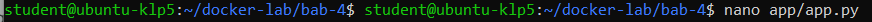

### File app/Dockerfile

```dockerfile
nano app/Dockerfile

FROM python:3.12-slim

WORKDIR /app

COPY requirements.txt .
RUN pip install --no-cache-dir -r requirements.txt

COPY app.py .

RUN useradd --system --uid 10001 --no-create-home appuser
USER appuser

EXPOSE 5000

CMD ["gunicorn", "--bind", "0.0.0.0:5000", "--workers", "2", "app:app"]
```

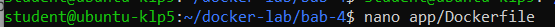

### Validasi

```bash
cd ~/docker-lab/bab-4
find . -maxdepth 3 -type f | sort
docker compose config
docker compose config --services
```

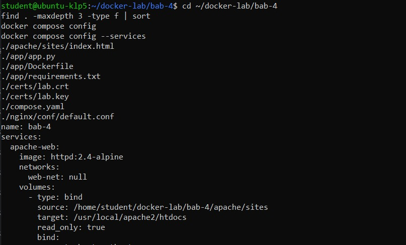

Service yang harus muncul:

```bash
proxy
apache-web
Flask-app
```

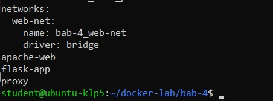

### Build dan Menjalankan Stack

```bash
docker compose up -d --build
docker compose ps
docker compose logs --tail 100
```

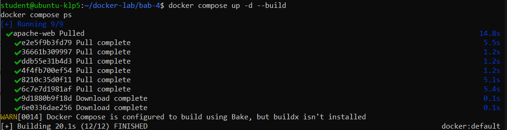

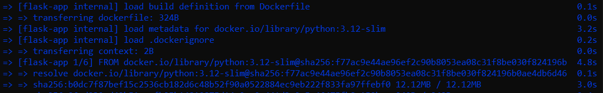

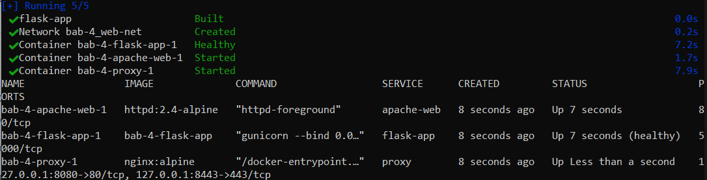

### Pengujian Cepat

```bash
curl -I http://localhost:8080/

curl -k -i https://localhost:8443/

curl -k https://localhost:8443/api/

curl -k -i https://localhost:8443/api/health

openssl s_client \
  -connect localhost:8443 \
  -servername localhost \
  -brief </dev/null
curl -k hanya digunakan untuk sertifikat self-signed laboratorium.

```

### Pemeriksaan Isolasi

```bash
docker compose ps
docker network inspect bab-4_web-net
docker compose exec proxy wget -qO- http://apache-web/
docker compose exec proxy wget -qO- http://flask-app:5000/health
```

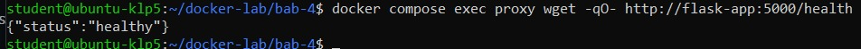

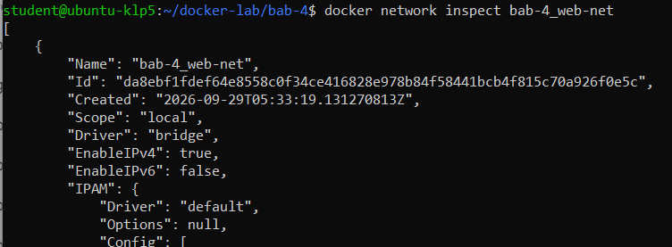

Hanya proxy yang boleh memiliki published port.

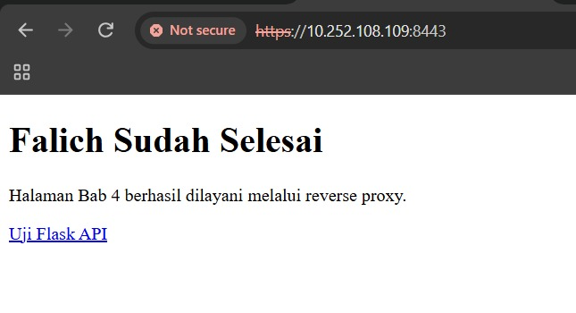

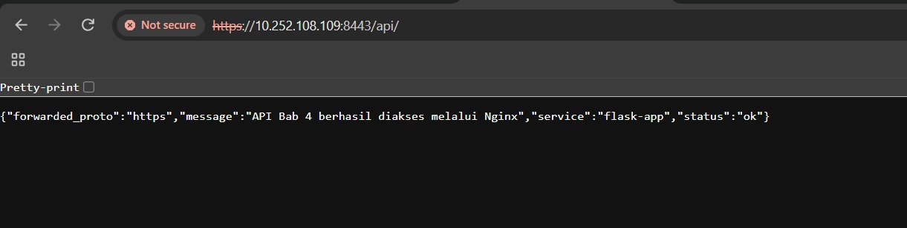

### Log

```bash
docker compose logs proxy
docker compose logs apache-web
docker compose logs flask-app
tail -n 20 logs/nginx/access.log
tail -n 20 logs/nginx/error.log
```

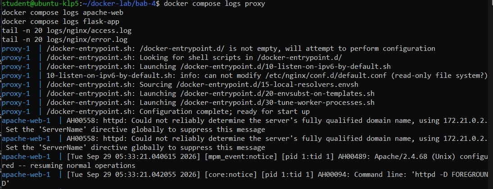

### Cleanup

```bash
cd ~/docker-lab/bab-4
docker compose down
```

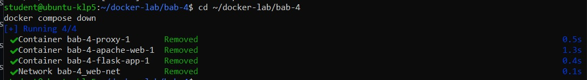

Hapus image lokal hasil build bila diperlukan:

```bash
docker compose down --rmi local
```

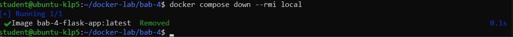

