# Praktikum 06: Centralized Logging dengan Fluent Bit dan PostgreSQL

> **Mata Kuliah:** Workshop DevOps  
> **Dosen Pengampu:** Dr. Ferry Astika Saputra, S.T., M.Sc.  
> **Kelompok:** 5  
> **Anggota:**
> - Muhammad Fajrul Fatih Abul ‘Ilmi (3124600040)
> - Nur Aini Agusthina (3124600050)
> - Abdullah Falich (3124600059)
> 
> **Program Studi:** D4 Teknik Informatika, Departemen Teknik Informatika dan Komputer  
> **Institusi:** Politeknik Elektronika Negeri Surabaya (PENS) - 2026

---

## PRAKTIKUM

### Menyiapkan Direktori

```bash
mkdir -p ~/docker-lab/bab-6/{init,fluent-bit,queries,scripts}
cd ~/docker-lab/bab-6

```

Struktur file:

```text
bab-6/
├── .env.example
├── .env
├── .gitignore
├── compose.yaml
├── fluent-bit/
│   └── fluent-bit.conf
├── init/
│   └── 01-init-logging.sh
├── queries/
│   └── analysis.sql
└── scripts/
    ├── generate-logs.sh
    └── test-buffering.sh

```

#### File .env.example

> **Nama file:** `.env.example`  
> **Lokasi:** `~/docker-lab/bab-6/.env.example`  
> **Buka editor:** `nano .env.example`  
> **Tujuan:** `memusatkan parameter lab tanpa menaruh credential aktif pada compose.yaml.`  
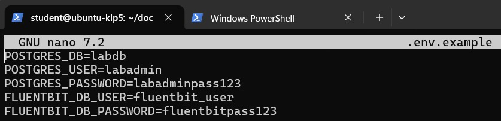

Aktifkan konfigurasi lokal:

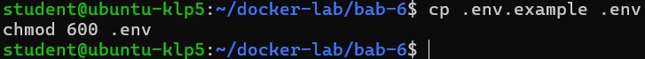

Nilai tersebut hanya untuk laptop laboratorium. File .env bukan secret manager dan tidak boleh digunakan sebagai pola penyimpanan secret di lingkungan produksi.

#### File .gitignore

> **Nama file:** `.gitignore`  
> **Lokasi:** `~/docker-lab/bab-6/.gitignore`  
> **Buka editor:** `nano .gitignore`  
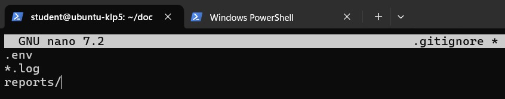

Volume PostgreSQL dan buffer Fluent Bit dikelola Docker sehingga tidak perlu dimasukkan ke repository.

#### File compose.yaml

> **Nama file:** `compose.yaml`  
> **Lokasi:** `~/docker-lab/bab-6/compose.yaml`  
> **Buka editor:** `nano compose.yaml`  
> **Petunjuk:** `Gunakan spasi, bukan tab. Semua nilai logging.options sengaja ditulis sebagai string.`  
```yaml
services:
  postgres-db:
    image: postgres:16-alpine
    environment:
      POSTGRES_DB: ${POSTGRES_DB}
      POSTGRES_USER: ${POSTGRES_USER}
      POSTGRES_PASSWORD: ${POSTGRES_PASSWORD}
      FLUENTBIT_DB_USER: ${FLUENTBIT_DB_USER}
      FLUENTBIT_DB_PASSWORD: ${FLUENTBIT_DB_PASSWORD}
    volumes:
      - pg-data:/var/lib/postgresql/data
      - ./init:/docker-entrypoint-initdb.d:ro
    networks:
      - logging-net
    healthcheck:
      test:
        - CMD-SHELL
        - "pg_isready -U $${POSTGRES_USER} -d $${POSTGRES_DB}"
      interval: 5s
      timeout: 5s
      retries: 12
      start_period: 10s
    restart: unless-stopped

  fluent-bit:
    image: fluent/fluent-bit:4.2.8
    environment:
      POSTGRES_DB: ${POSTGRES_DB}
      FLUENTBIT_DB_USER: ${FLUENTBIT_DB_USER}
      FLUENTBIT_DB_PASSWORD: ${FLUENTBIT_DB_PASSWORD}
    volumes:
      - ./fluent-bit/fluent-bit.conf:/fluent-bit/etc/fluent-bit.conf:ro
      - flb-storage:/var/log/flb-storage
    ports:
      - "127.0.0.1:24224:24224"
      - "127.0.0.1:2020:2020"
    networks:
      - logging-net
    depends_on:
      postgres-db:
        condition: service_healthy
    security_opt:
      - no-new-privileges:true
    restart: unless-stopped

  generator-auth:
    image: alpine:3.20
    command:
      - /bin/sh
      - -c
      - |
        i=1
        while [ "$$i" -le 20 ]; do
          printf '{"service":"auth","severity":"INFO","event":"login_test","sequence":%s}\n' "$$i"
          i=$$((i + 1))
          sleep 1
        done
    logging:
      driver: fluentd
      options:
        fluentd-address: "127.0.0.1:24224"
        fluentd-async: "true"
        tag: "docker.{{.Name}}"
    depends_on:
      - fluent-bit

  generator-api:
    image: alpine:3.20
    command:
      - /bin/sh
      - -c
      - |
        i=1
        while [ "$$i" -le 20 ]; do
          printf '{"service":"api","severity":"WARN","event":"latency_test","duration_ms":%s}\n' "$$((i * 10))"
          i=$$((i + 1))
          sleep 1
        done
    logging:
      driver: fluentd
      options:
        fluentd-address: "127.0.0.1:24224"
        fluentd-async: "true"
        tag: "docker.{{.Name}}"
    depends_on:
      - fluent-bit

  generator-worker:
    image: alpine:3.20
    command:
      - /bin/sh
      - -c
      - |
        i=1
        while [ "$$i" -le 20 ]; do
          printf '{"service":"worker","severity":"ERROR","event":"retry_test","attempt":%s}\n' "$$i"
          i=$$((i + 1))
          sleep 1
        done
    logging:
      driver: fluentd
      options:
        fluentd-address: "127.0.0.1:24224"
        fluentd-async: "true"
        tag: "docker.{{.Name}}"
    depends_on:
      - fluent-bit

volumes:
  pg-data:
  flb-storage:

networks:
  logging-net:
    driver: bridge
```

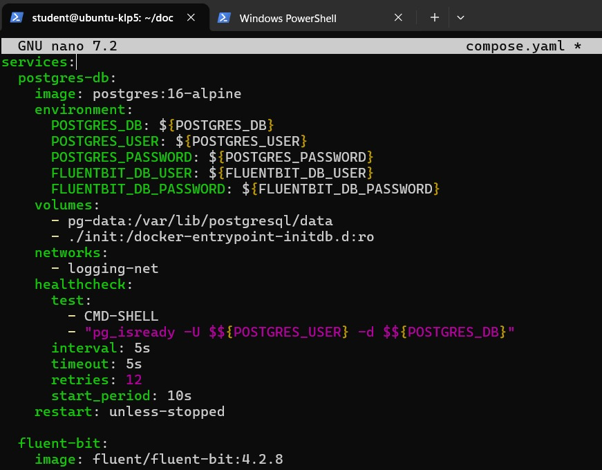

fluentd-async: "true" membuat Docker mencoba tersambung di latar belakang sehingga kegagalan collector tidak langsung menggagalkan startup container. Buffer driver Docker tetap terbatas dan berbeda dari buffer filesystem Fluent Bit; keduanya tidak menjamin kehilangan data mustahil terjadi.

#### File init/01-init-logging.sh

> **Nama file:** `01-init-logging.sh`  
> **Lokasi:** `~/docker-lab/bab-6/init/01-init-logging.sh`  
> **Buka editor:** `nano init/01-init-logging.sh`  
> **Tujuan:** `membuat objek database dengan nama dan tipe kolom yang sesuai kontrak plugin PostgreSQL Fluent Bit.`  
```bash
#!/usr/bin/env bash
set -Eeuo pipefail

: "${POSTGRES_USER:?POSTGRES_USER belum diatur}"
: "${POSTGRES_DB:?POSTGRES_DB belum diatur}"
: "${FLUENTBIT_DB_USER:?FLUENTBIT_DB_USER belum diatur}"
: "${FLUENTBIT_DB_PASSWORD:?FLUENTBIT_DB_PASSWORD belum diatur}"

psql \
  --set=ON_ERROR_STOP=1 \
  --username "$POSTGRES_USER" \
  --dbname "$POSTGRES_DB" \
  --set=fb_user="$FLUENTBIT_DB_USER" \
  --set=fb_password="$FLUENTBIT_DB_PASSWORD" <<'SQL'
SELECT format(
    'CREATE ROLE %I LOGIN PASSWORD %L',
    :'fb_user',
    :'fb_password'
)
WHERE NOT EXISTS (
    SELECT 1 FROM pg_roles WHERE rolname = :'fb_user'
)
\gexec

CREATE SCHEMA IF NOT EXISTS logs;

CREATE TABLE IF NOT EXISTS logs.fluentbit (
    tag  TEXT NOT NULL,
    time TIMESTAMP WITHOUT TIME ZONE NOT NULL,
    data JSONB NOT NULL
);

CREATE INDEX IF NOT EXISTS idx_fluentbit_time
    ON logs.fluentbit (time DESC);

CREATE INDEX IF NOT EXISTS idx_fluentbit_tag
    ON logs.fluentbit (tag);

CREATE INDEX IF NOT EXISTS idx_fluentbit_data_gin
    ON logs.fluentbit USING GIN (data);

CREATE OR REPLACE VIEW logs.recent_logs AS
SELECT
    time,
    tag,

    replace(data ->> 'container_name', '/', '') AS container_name,
    data ->> 'source' AS source,
    left(data ->> 'log', 200) AS log_preview
FROM logs.fluentbit
ORDER BY time DESC
LIMIT 100;

SELECT format(
    'ALTER ROLE %I IN DATABASE %I SET search_path TO logs, public',
    :'fb_user',
    current_database()
)
\gexec

SELECT format('GRANT USAGE, CREATE ON SCHEMA logs TO %I', :'fb_user')
\gexec

SELECT format(
    'GRANT SELECT, INSERT ON TABLE logs.fluentbit TO %I',
    :'fb_user'
)
\gexec

SELECT format('GRANT SELECT ON TABLE logs.recent_logs TO %I', :'fb_user')
\gexec
SQL
```

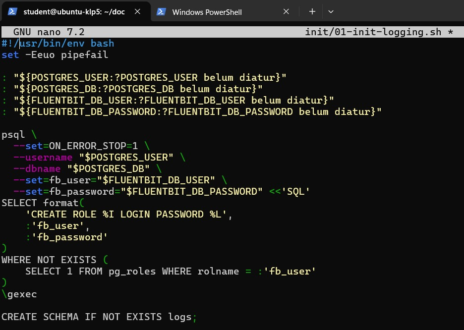

Hak CREATE pada schema diperlukan karena plugin PostgreSQL dapat melakukan bootstrap tabel. Untuk produksi, proses bootstrap sebaiknya dipisahkan dari akun ingest; setelah schema stabil, evaluasi pencabutan hak DDL dan uji kembali kompatibilitas plugin.

#### File fluent-bit/fluent-bit.conf

> **Nama file:** `fluent-bit.conf`  
> **Lokasi:** `~/docker-lab/bab-6/fluent-bit/fluent-bit.conf`  
> **Buka editor:** `nano fluent-bit/fluent-bit.conf`  
> **Tujuan:** `menerima protokol Forward, menahan backlog pada volume, serta meneruskan record ke PostgreSQL dan stdout.`  
```bash
[SERVICE]
    Flush                     1
    Daemon                    Off
    Log_Level                 info
    storage.path              /var/log/flb-storage
    storage.sync              normal
    storage.checksum          on
    storage.backlog.mem_limit 10M
    HTTP_Server               On
    HTTP_Listen               0.0.0.0
    HTTP_Port                 2020

[INPUT]
    Name          forward
    Listen        0.0.0.0
    Port          24224
    Mem_Buf_Limit 10M
    storage.type  filesystem

[OUTPUT]
    Name                     pgsql
    Match                    *
    Host                     postgres-db
    Port                     5432
    User                     ${FLUENTBIT_DB_USER}
    Password                 ${FLUENTBIT_DB_PASSWORD}
    Database                 ${POSTGRES_DB}
    Table                    fluentbit
    storage.total_limit_size 256M

[OUTPUT]
    Name   stdout
    Match  *
    Format json_lines
```

Keluaran stdout merupakan jalur observasi tambahan untuk praktikum. Pada sistem sibuk, keluaran ini dapat menambah volume log internal dan sebaiknya disesuaikan dengan kebutuhan.

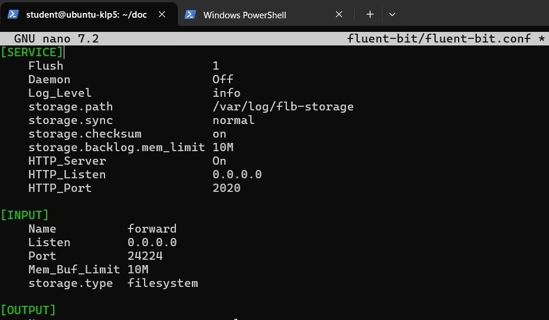

#### File queries/analysis.sql

> **Nama file:** `analysis.sql`  
> **Lokasi:** `~/docker-lab/bab-6/queries/analysis.sql`  
> **Buka editor:** `nano queries/analysis.sql`  
```sql
\pset pager off
\timing on

-- 1. Jumlah event dan rentang waktu.
SELECT
    count(*) AS total_event,
    min(time) AS event_pertama,
    max(time) AS event_terakhir
FROM logs.fluentbit;

-- 2. Distribusi berdasarkan tag Docker.
SELECT
    tag,
    count(*) AS total
FROM logs.fluentbit
GROUP BY tag
ORDER BY total DESC, tag;

-- 3. Metadata terstruktur dari Docker logging driver.
SELECT
    time,
    tag,
    replace(data ->> 'container_name', '/', '') AS container_name,
    data ->> 'source' AS source,
    left(data ->> 'log', 160) AS log_preview
FROM logs.fluentbit
ORDER BY time DESC
LIMIT 15;

-- 4. Pencarian severity pada JSON yang masih berada di field log.
SELECT
    time,
    tag,
    data ->> 'log' AS log_message
FROM logs.fluentbit
WHERE data ->> 'log' ILIKE '%"severity":"ERROR"%'
ORDER BY time DESC;

-- 5. Ringkasan per menit untuk mengamati laju ingest.
SELECT
    date_trunc('minute', time) AS minute_bucket,
    count(*) AS total
FROM logs.fluentbit
GROUP BY minute_bucket
ORDER BY minute_bucket DESC
LIMIT 10;

-- Contoh retensi; tinjau dahulu sebelum menghapus data.
-- DELETE FROM logs.fluentbit
-- WHERE time < CURRENT_TIMESTAMP - INTERVAL '7 days';
```

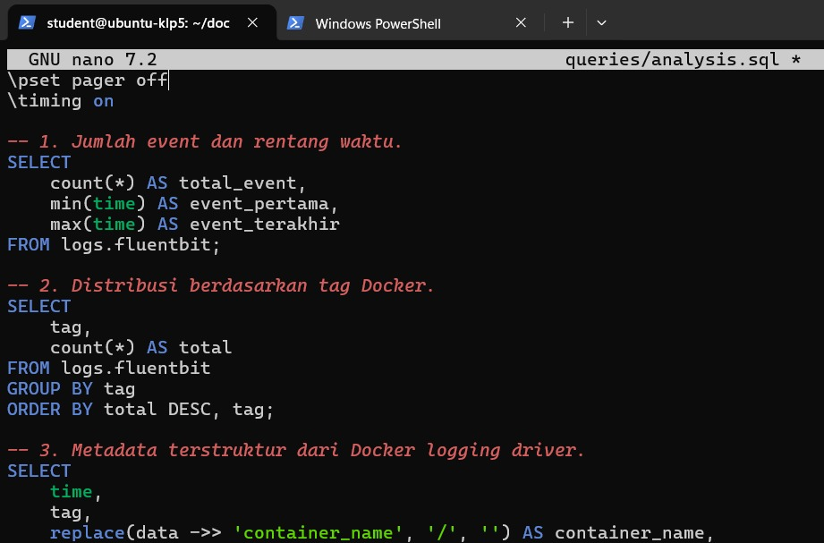

Pesan aplikasi berbentuk JSON masih disimpan sebagai string pada data.log, sedangkan metadata Docker berada pada objek data. Praktikum lanjutan dapat menambahkan parser Fluent Bit agar isi data.log diangkat menjadi field terstruktur tersendiri.

#### File scripts/generate-logs.sh

> **Nama file:** `generate-logs.sh`  
> **Lokasi:** `~/docker-lab/bab-6/scripts/generate-logs.sh`  
> **Buka editor:** `nano scripts/generate-logs.sh`  
```bash
#!/usr/bin/env bash
set -Eeuo pipefail

cd "$(dirname "$0")/.."

if [[ ! -f .env ]]; then
    echo "[FAIL] File .env tidak ditemukan." >&2
    exit 1
fi

docker compose up -d postgres-db fluent-bit

for attempt in {1..30}; do
    if curl -fsS http://127.0.0.1:2020/api/v1/health >/dev/null; then
        break
    fi

    if [[ "$attempt" -eq 30 ]]; then
        echo "[FAIL] Endpoint kesehatan Fluent Bit belum siap." >&2
        exit 1
    fi
    sleep 2
done

docker compose up -d --force-recreate \
    generator-auth \
    generator-api \
    generator-worker

echo "[PASS] Tiga generator telah dijalankan. Tunggu sekitar 25 detik."
echo "[INFO] Pantau dengan: docker compose ps"
```

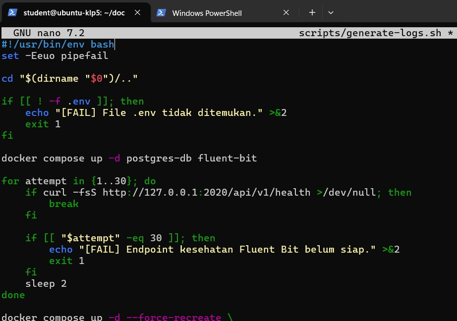

#### File scripts/test-buffering.sh

> **Nama file:** `test-buffering.sh`  
> **Lokasi:** `~/docker-lab/bab-6/scripts/test-buffering.sh`  
> **Buka editor:** `nano scripts/test-buffering.sh`  
> **Tujuan:** `membuktikan bahwa Fluent Bit menahan event ketika PostgreSQL dihentikan sementara, lalu mengirimkannya setelah backend pulih.`  
```bash
#!/usr/bin/env bash
set -Eeuo pipefail

cd "$(dirname "$0")/.."

if [[ ! -f .env ]]; then
    echo "[FAIL] File .env tidak ditemukan." >&2
    exit 1
fi

set -a
source .env
set +a

count_rows() {
    docker compose exec -T postgres-db \
        psql \
        --username "$POSTGRES_USER" \
        --dbname "$POSTGRES_DB" \
        --tuples-only \
        --no-align \
        --command 'SELECT count(*) FROM logs.fluentbit;'
}

before="$(count_rows)"
echo "[INFO] Jumlah awal: $before"

docker compose stop postgres-db

docker compose up -d --force-recreate \
    generator-auth \
    generator-api \
    generator-worker

echo "[INFO] PostgreSQL berhenti; generator berjalan selama 25 detik."
sleep 25

docker compose start postgres-db

for attempt in {1..30}; do
    if docker compose exec -T postgres-db \
        pg_isready -U "$POSTGRES_USER" -d "$POSTGRES_DB" >/dev/null 2>&1; then
        break
    fi

    if [[ "$attempt" -eq 30 ]]; then
        echo "[FAIL] PostgreSQL tidak kembali sehat." >&2
        exit 1
    fi
    sleep 2
done

for attempt in {1..60}; do
    after="$(count_rows)"
    if (( after > before )); then
        echo "[PASS] Jumlah sesudah pemulihan: $after"
        echo "[INFO] Kenaikan record: $((after - before))"
        exit 0
    fi
    sleep 2
done

echo "[FAIL] Tidak ada record baru setelah PostgreSQL pulih." >&2
echo "[INFO] Periksa: docker compose logs --tail 200 fluent-bit" >&2
exit 1
```

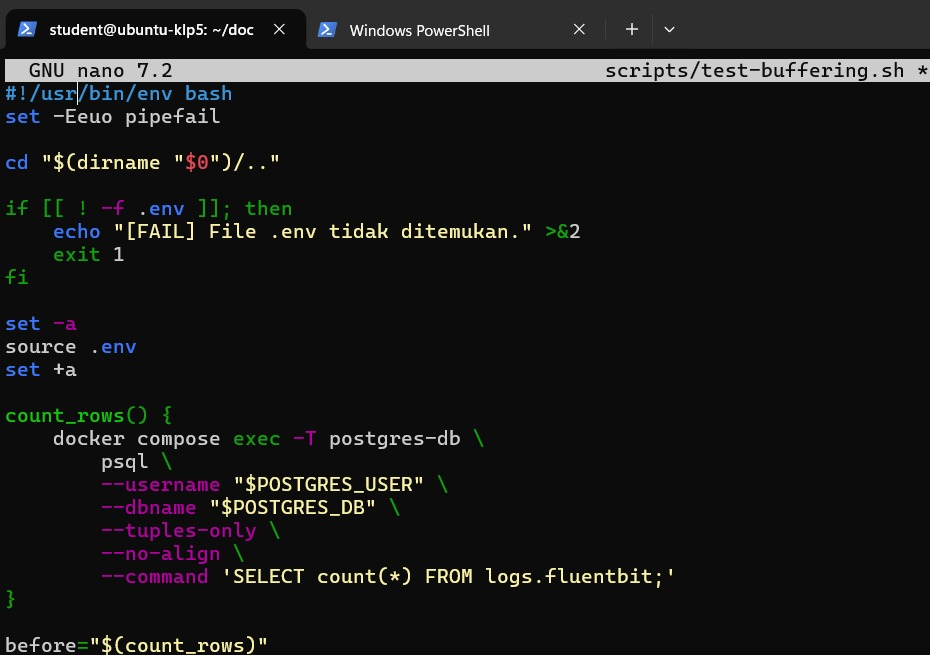

Pengujian ini membuktikan pemulihan pada skala lab, bukan jaminan exactly-once. Retry dapat menghasilkan duplikasi, sedangkan buffer penuh, disk gagal, atau proses dihentikan secara paksa tetap dapat menyebabkan kehilangan event.

### Memberi Izin Eksekusi dan Memvalidasi Berkas

```bash
chmod +x init/01-init-logging.sh
chmod +x scripts/generate-logs.sh scripts/test-buffering.sh

bash -n init/01-init-logging.sh
bash -n scripts/generate-logs.sh
bash -n scripts/test-buffering.sh
docker compose config --quiet
```

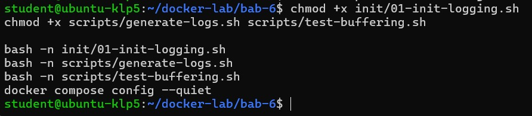

Validasi konfigurasi Fluent Bit tanpa menjalankan seluruh stack:

```bash
docker compose run --rm --no-deps fluent-bit \
  --dry-run \
  --config=/fluent-bit/etc/fluent-bit.conf
```

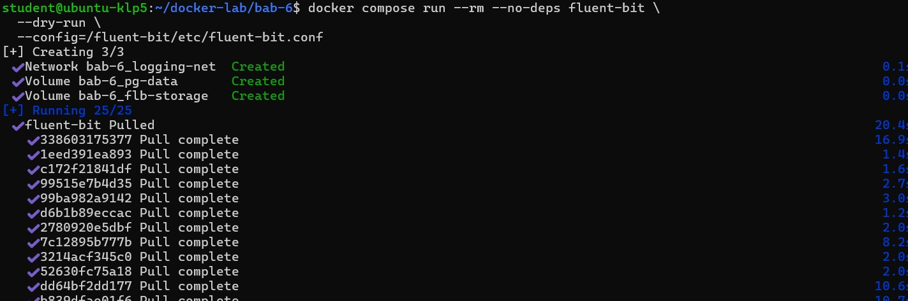

Jika versi image tidak mengenali --dry-run, validasi dilakukan dengan menjalankan service dan memeriksa log startup:

```bash
docker compose up -d postgres-db fluent-bit
docker compose logs --tail 100 fluent-bit

```

### Menjalankan Pipeline dan Menghasilkan Log

```bash
./scripts/generate-logs.sh
sleep 25
docker compose ps --all
```

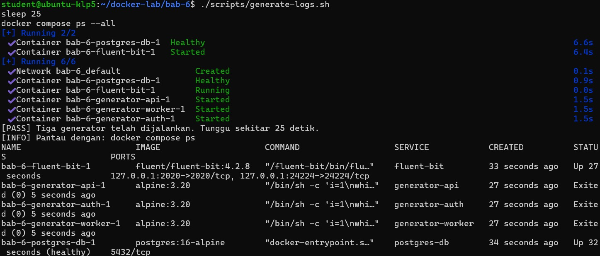

Status Exited (0) pada ketiga generator setelah sekitar 20 detik merupakan hasil normal karena proses generator telah selesai. Service PostgreSQL dan Fluent Bit harus tetap Up.

### Memeriksa Monitoring Fluent Bit

```bash
curl -fsS http://127.0.0.1:2020/api/v1/health
curl -fsS http://127.0.0.1:2020/api/v1/metrics
```

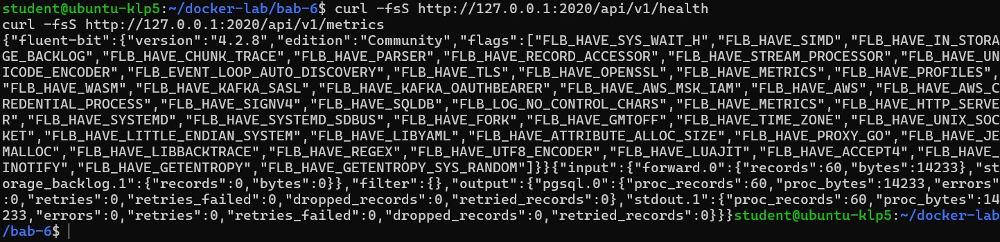

Endpoint monitoring hanya diikat ke 127.0.0.1. Jangan membuka endpoint internal ini ke jaringan publik tanpa autentikasi, pembatasan jaringan, dan kebijakan akses yang sesuai.

### Memverifikasi Record PostgreSQL

```bash
set -a
source .env
set +a

docker compose exec -T postgres-db \
  psql \
  --username "$POSTGRES_USER" \
  --dbname "$POSTGRES_DB" \
  --file /dev/stdin \
  < queries/analysis.sql
```

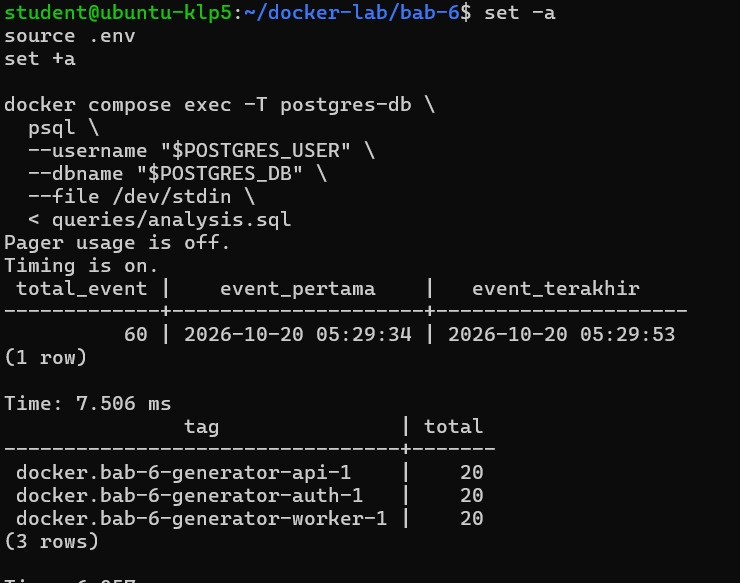

Pemeriksaan ringkas terhadap view:

```bash
docker compose exec -T postgres-db \
  psql \
  --username "$POSTGRES_USER" \
  --dbname "$POSTGRES_DB" \
  --command 'TABLE logs.recent_logs;'
```

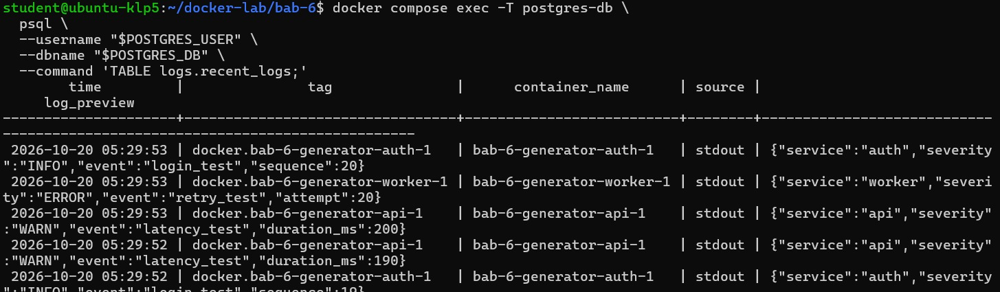

Contoh evidence yang diharapkan (jumlah aktual dapat berbeda akibat waktu startup dan retry):

```bash
           tag            | total
--------------------------+-------
 docker.bab-6-generator-* |    20

 container_name           | source | log_preview
--------------------------+--------+------------------------------------------
 bab-6-generator-worker-1 | stdout | {"service":"worker","severity":...

```

### Menguji Buffering dan Pemulihan

Pastikan pipeline normal telah menghasilkan record, kemudian jalankan:

```bash
./scripts/test-buffering.sh
```

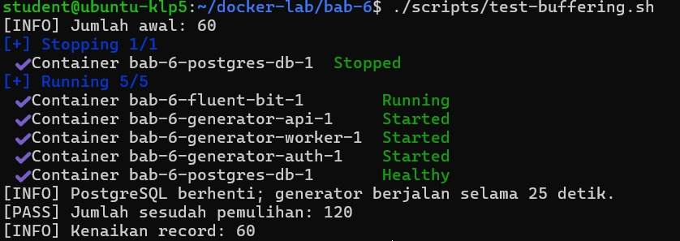

Selama PostgreSQL berhenti, perhatikan retry Fluent Bit dan kondisi buffer:

```bash
docker compose logs --tail 200 fluent-bit
docker compose volume ls
```

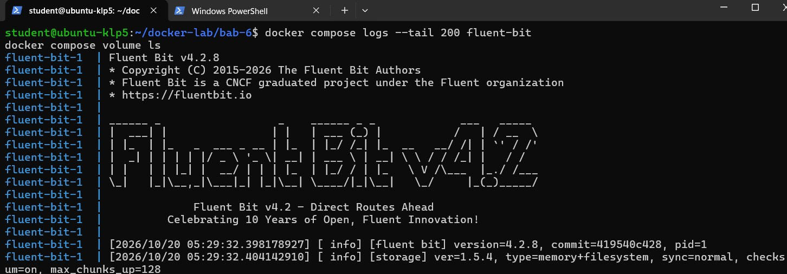

Kriteria utama bukan bahwa tidak ada pesan galat, melainkan bahwa kegagalan output terlihat, service collector tetap berjalan, dan jumlah record bertambah setelah PostgreSQL pulih.

Verifikasi tipe data dapat dilakukan dengan:

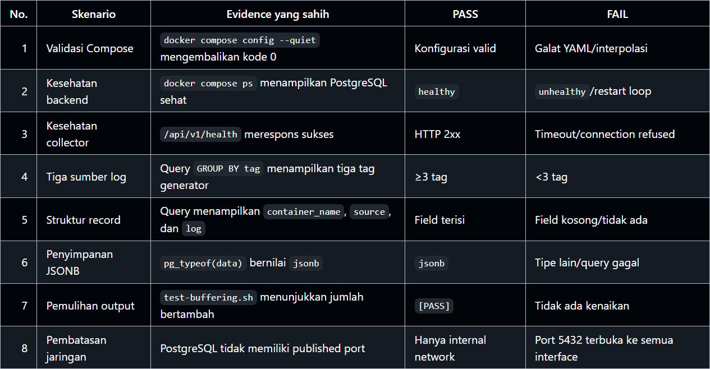

```bash
docker compose exec -T postgres-db \
  psql \
  --username "$POSTGRES_USER" \
  --dbname "$POSTGRES_DB" \
  --command 'SELECT pg_typeof(data), count(*) FROM logs.fluentbit GROUP BY pg_typeof(data);'

```

### Cleanup

Menghentikan container tanpa menghapus data:

```bash
docker compose down --remove-orphans
```

Menghapus seluruh container dan volume lab (termasuk tabel log serta backlog Fluent Bit):

```bash
docker compose down --volumes --remove-orphans
```

Perintah kedua bersifat destruktif terhadap data praktikum. Gunakan hanya setelah evidence yang diperlukan telah disimpan.

## MENCOBA DENGAN BERBAGAI SKENARIO

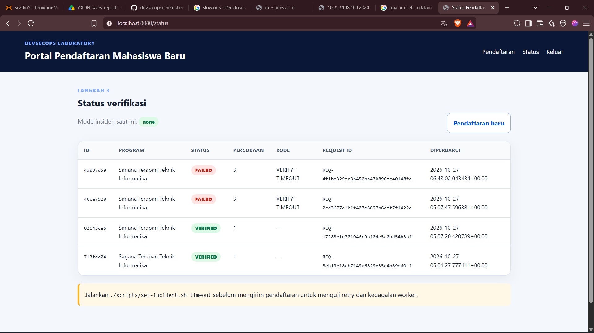

### Skenario 1: Alur normal

Jalankan otomatis:

```bash
./scripts/demo-normal.sh
```

Alur yang diharapkan:

login_success

  → registration_submitted

  → verification_started

  → verification_completed

  → status VERIFIED

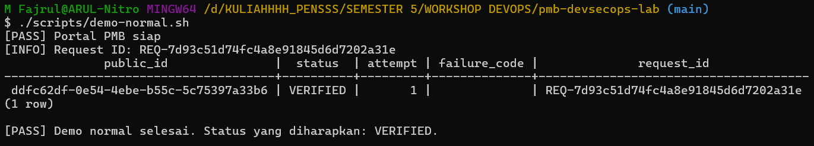

Atau lakukan manual:

Aktifkan mode normal ./scripts/set-incident.sh none.

Login ke portal.

Isi data sintetis dan kirim formulir.

Buka halaman Status.

Tunggu sampai status berubah menjadi VERIFIED.

### Skenario 2: Timeout dependency

Jalankan otomatis:

```bash
./scripts/demo-incident.sh
```

Alur yang diharapkan:

login_success

  → registration_submitted

  → verification_started

  → verification_retry × 3

  → dependency_timeout

  → status FAILED / VERIFY-TIMEOUT

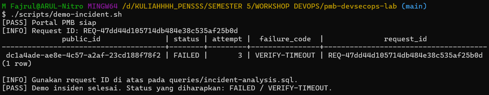

Untuk menjalankan manual:

```bash
./scripts/set-incident.sh timeout
```

Kirim pendaftaran baru melalui browser, lalu kembalikan sistem ke mode normal:

```bash
./scripts/set-incident.sh none
```

Pendaftaran yang sudah FAILED sengaja tidak diproses ulang secara otomatis. Buat transaksi baru untuk membuktikan recovery.

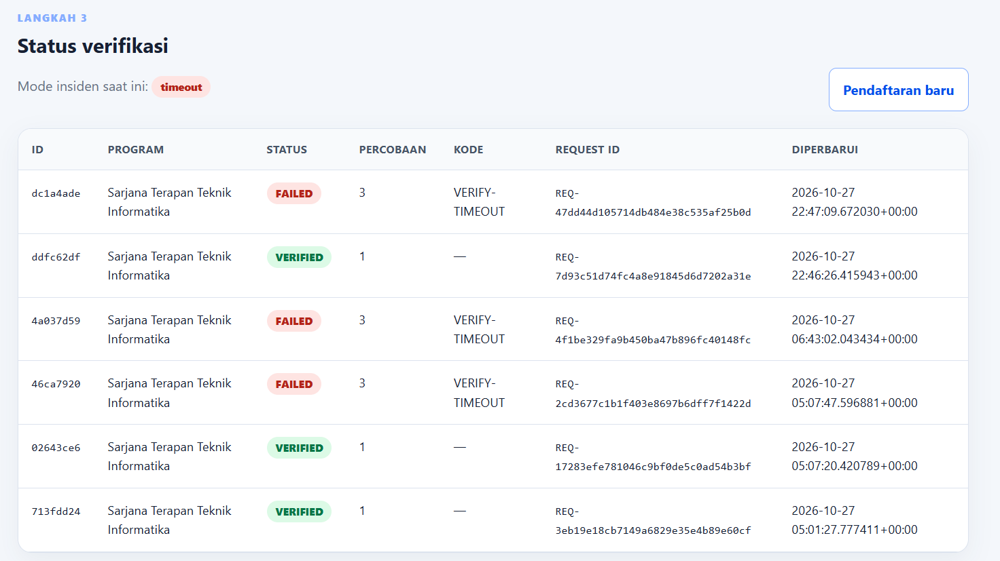

**Fluent Bit (Pengumpul Log / Log Collector)**

Perangkat lunak (software) ringan yang dirancang khusus untuk mengumpulkan, mem-parsing, memfilter, dan meneruskan data log dari berbagai sumber ke tempat penyimpanan pusat (seperti Elasticsearch, Grafana Loki, atau S3).

| Fungsi | : | Membaca file log dari aplikasi atau kontainer, mengubah formatnya jika perlu, lalu mengirimkannya dengan beban CPU dan memori yang sangat kecil. |
| --- | --- | --- |
| Catatan | : | Meskipun Fluent Bit punya fitur mengekspos metrik internal dirinya sendiri ke format Prometheus, tugas utamanya tetap mengurus log. |

**Prometheus (Sistem Pemantauan Metrik / Metrics Monitoring)**

Sistem pemantauan dan basis data time-series yang dirancang untuk mengambil dan menyimpan metrik numerik (contoh: penggunaan CPU 75%, jumlah pengguna aktif 120 orang, atau durasi respon HTTP 0.2 detik).

| Fungsi | : | Melakukan scraping (menarik data secara berkala) dari endpoint aplikasi, menghasilkan grafik tren penggunaan sumber daya, serta memicu alert (peringatan) jika angka melewati batas tertentu. |
| --- | --- | --- |
| Catatan | : | Berupa data deret waktu numerik (angka + label), bukan teks naratif seperti log. |

