# Praktikum Virtualisasi: Konfigurasi Virtualisasi Proxmox VE

> **Mata Kuliah:** Workshop DevOps  
> **Dosen Pengampu:** Dr. Ferry Astika Saputra, S.T., M.Sc.  
> **Kelompok:** 5  
> **Anggota:**
> - Muhammad Fajrul Fatih Abul ‘Ilmi (3124600040)
> - Nur Aini Agusthina (3124600050)
> - Abdullah Falich (3124600059)
> 
> **Program Studi:** D4 Teknik Informatika, Departemen Teknik Informatika dan Komputer  
> **Institusi:** Politeknik Elektronika Negeri Surabaya (PENS) - 2026

---

## TOPOLOGI JARINGAN

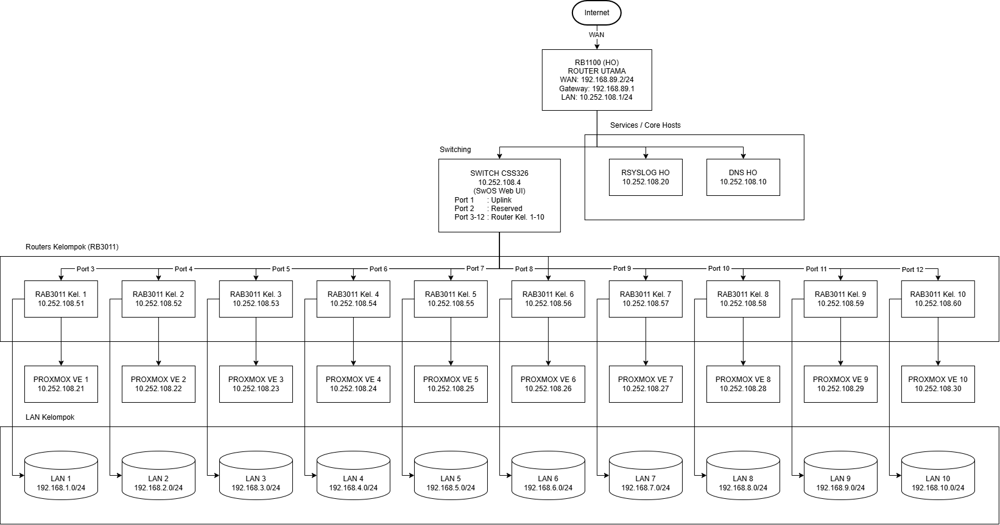

## IDENTIFIKASI TOPOLOGI JARINGAN

Topologi di atas menggunakan Topologi Hierarkis (Tree/Tree-Star Hybrid), dengan segmentasi bertingkat:

Core atau Gateway Layer: Internet terhubung langsung ke Router Utama RB1100 (HO) sebagai pusat kendali rute.

Distribution Layer: Trafik dari router utama didistribusikan melalui Switch CSS326 serta melayani infrastruktur pusat (DNS HO dan RSYSLOG HO).

Access Layer: Switch CSS326 mendistribusikan jalur melalui port 3-12 ke 10 unit router lokal kelompok (RB3011 Kel. 1-10).

Endpoint Layer: Masing-masing router membawahi node server virtualisasi (Proxmox VE) dan segmen subnet lokal mandiri (LAN Kelompok).

## IDENTIFIKASI KONFIGURASI DARI ROUTER

Router Utama (MikroTik RB1100 - HO)

Interface WAN: 192.168.89.2/24

Default Gateway: 192.168.89.1

Interface LAN (Backbone Core): 10.252.108.1/24

Peran Konfigurasi: Berfungsi sebagai gateway NAT, pusat perutean antar-subnet, serta penghubung ke server bersama (DNS: 10.252.108.10, RSYSLOG: 10.252.108.20).

Switch Distribusi (MikroTik CSS326)

IP Manajemen (SwOS): 10.252.108.4

Port Mapping:

Port 1: Uplink ke Router Utama RB1100

Port 2: Reserved (Cadangan)

Port 3-12: Distribusi ke Router Kelompok 1 hingga 10

Router Kelompok (MikroTik RB3011 Kel. 1-10)

Setiap router kelompok memiliki alamat IP uplink pada segmen backbone dan mengelola subnet LAN lokal tersendiri:

| Perangkat | IP Uplink (ke Backbone) | Subnet LAN Kelompok |
| --- | --- | --- |
| RB3011 Kel. 1 | 10.252.108.51 | 192.168.1.0/24 |
| RB3011 Kel. 2 | 10.252.108.52 | 192.168.2.0/24 |
| RB3011 Kel. 3 | 10.252.108.53 | 192.168.3.0/24 |
| RB3011 Kel. 4 | 10.252.108.54 | 192.168.4.0/24 |
| RB3011 Kel. 5 | 10.252.108.55 | 192.168.5.0/24 |
| RB3011 Kel. 6 | 10.252.108.56 | 192.168.6.0/24 |
| RB3011 Kel. 7 | 10.252.108.57 | 192.168.7.0/24 |
| RB3011 Kel. 8 | 10.252.108.58 | 192.168.8.0/24 |
| RB3011 Kel. 9 | 10.252.108.59 | 192.168.9.0/24 |
| RB3011 Kel. 10 | 10.252.108.60 | 192.168.10.0/24 |

## IDENTIFIKASI SPESIFIKASI PROXMOX

Diagram menyajikan rincian konfigurasi jaringan logis (IP addressing) untuk masing-masing node Proxmox VE:

Platform Sistem: Proxmox Virtual Environment (PVE) mandiri berjumlah 10 instance.

Segmentasi IP Manajemen: Berada pada subnet backbone yang sama dengan Router Utama (10.252.108.0/24), dengan pembagian alokasi:

Proxmox VE 1: 10.252.108.21

Proxmox VE 2: 10.252.108.22

Proxmox VE 3: 10.252.108.23

Proxmox VE 4: 10.252.108.24

Proxmox VE 5: 10.252.108.25

Proxmox VE 6: 10.252.108.26

Proxmox VE 7: 10.252.108.27

Proxmox VE 8: 10.252.108.28

Proxmox VE 9: 10.252.108.29

Proxmox VE 10: 10.252.108.30

Spesifikasi Perangkat Keras: Diagram ini merupakan diagram topologi jaringan logis, sehingga detail perangkat keras fisik seperti model prosesor, kapasitas RAM, dan media penyimpanan storage tidak dicantumkan di dalam skema.

## MEMBUAT 1 VM

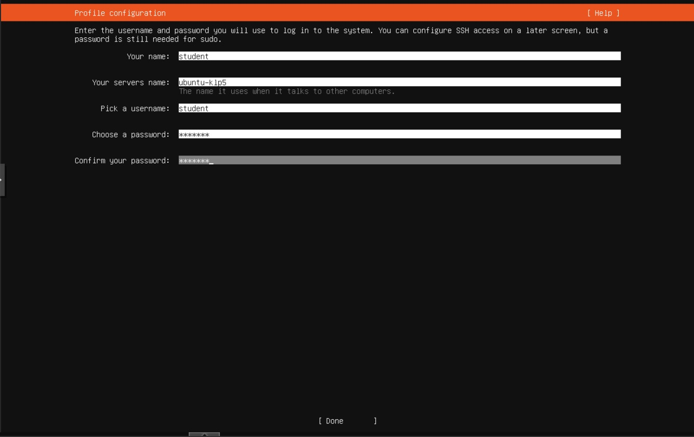

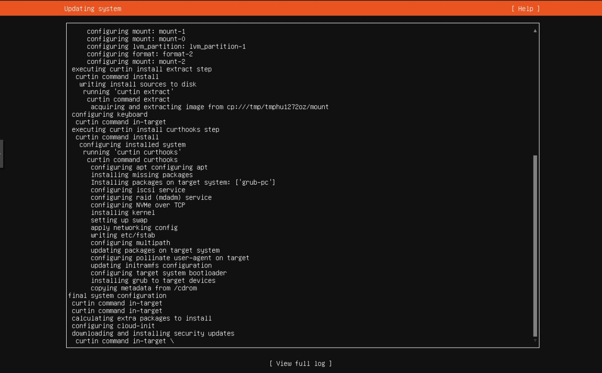

## MEMBUAT 1 CONTAINER

### Langkah 1: Mengunduh Template Ubuntu

Pada menu sebelah kiri (Server View), klik penyimpanan lokal srv-h05.

Pilih menu CT Templates di panel sebelah kanan.

Klik tombol Templates yang ada di bagian atas.

Pilih OS Ubuntu (Ubuntu 24.04 standard), lalu klik Download.

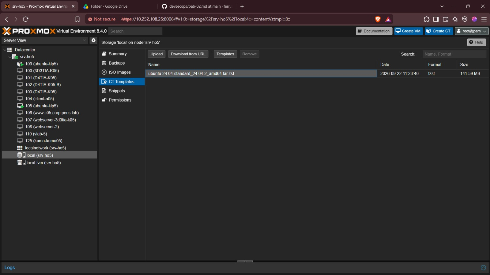

### Langkah 2: Membuat Container Baru

Di pojok kanan atas, klik Create CT.

Tab General:

Node		: srv-ho5

CT ID		: 109 (default Proxmox)

Hostname	: ubuntu-klp5

Password	: student

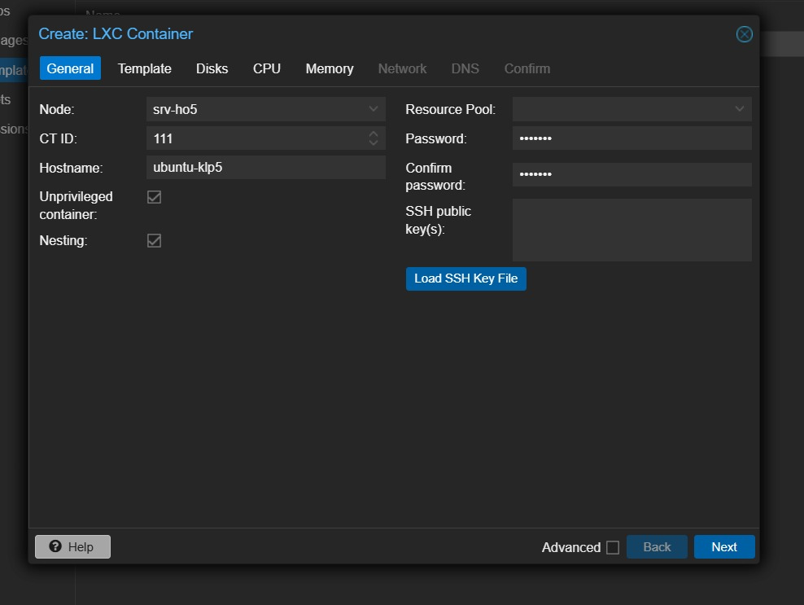

Tab Template:

Storage		: local (tempat template diunduh)

Template	: ubuntu-24.04-standard_24.04-2 (template yang baru diunduh)

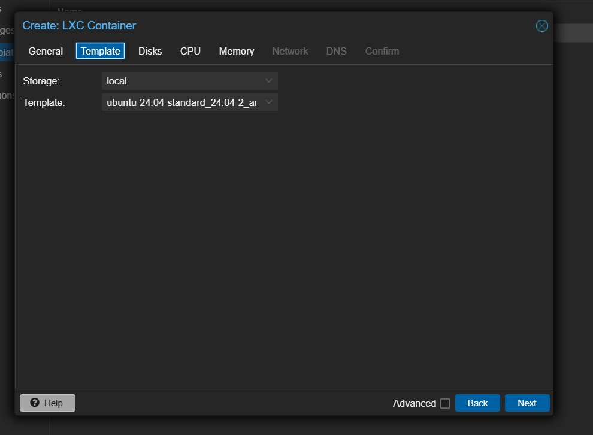

Tab Disks:

Storage		: local-lvm (lokasi untuk menyimpan disk virtual container)

Disk size (GiB)	: 20

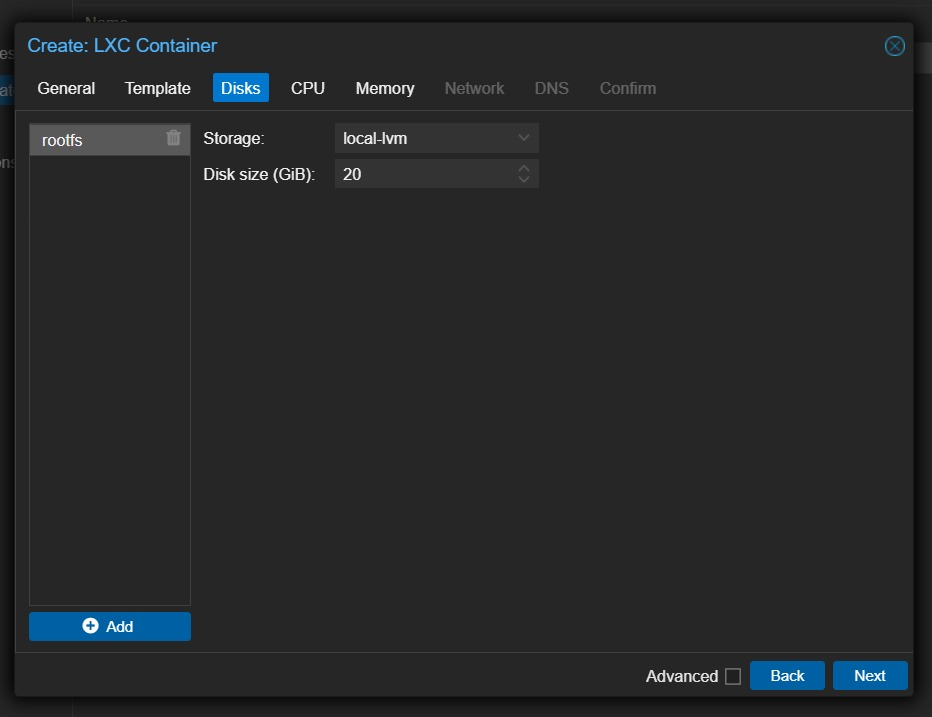

Tab CPU:

Cores		: 1 (untuk mengatur 1 core CPU)

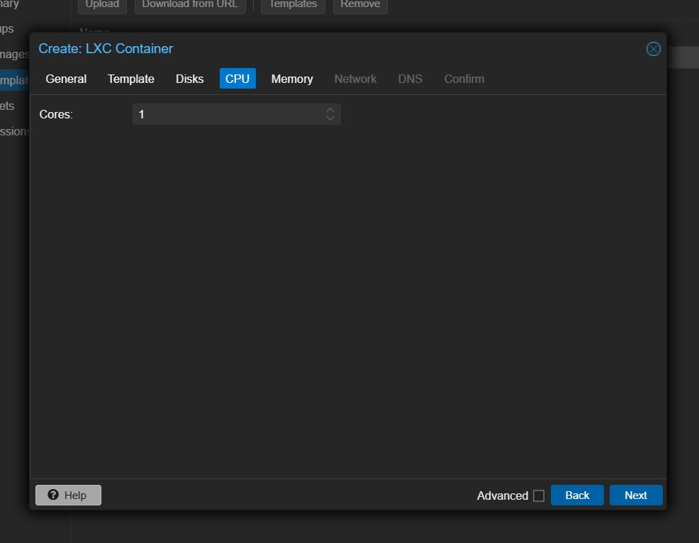

Tab Memory:

Memory (MiB)	: 2048

Swap (MiB)	: 512 (default)

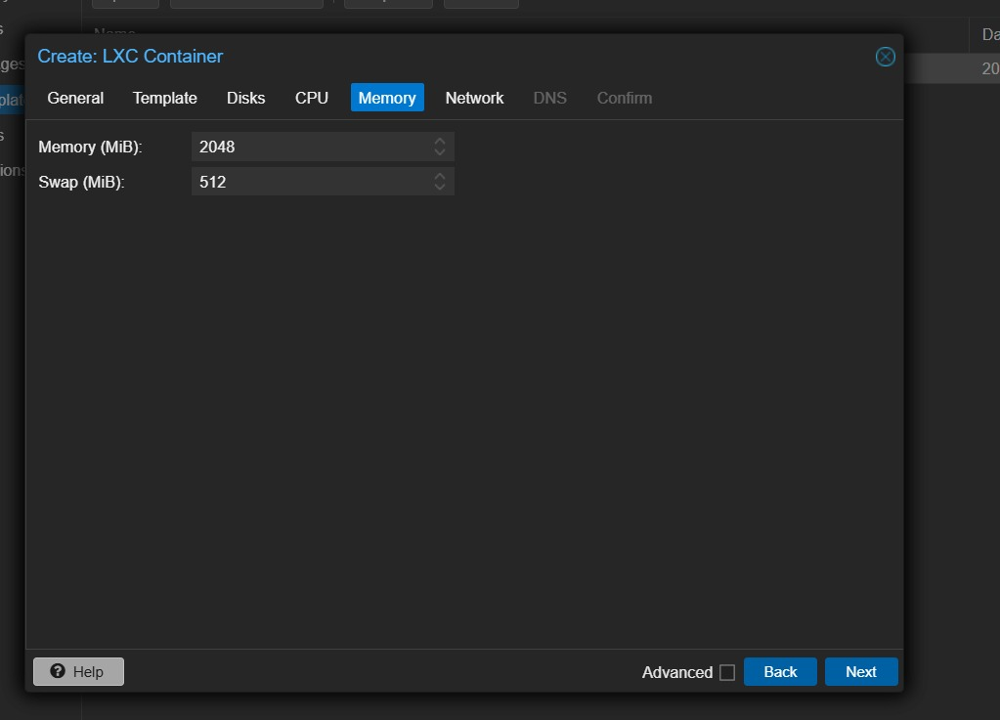

Tab Network:

Bridge		: vmbr0 (standar bawaan)

IPv4		: Static

IPv4/CIDR	: 10.252.108.110/24

Gateway	: 10.252.108.1

IPv6		: Static

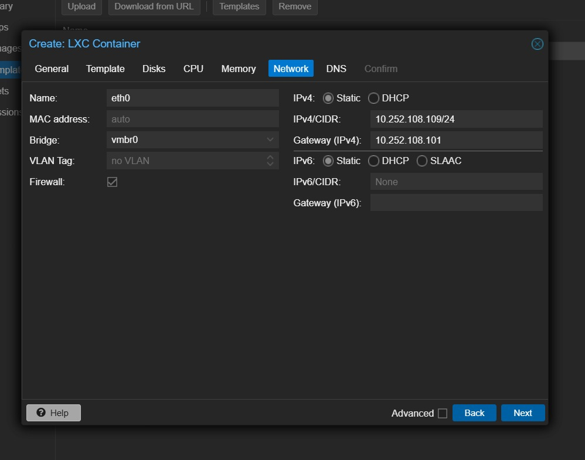

Tab DNS:

Biarkan kosong agar mengikuti pengaturan dari Host, lalu klik Next.

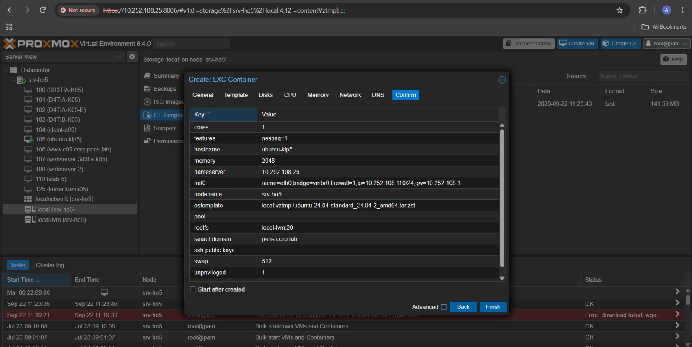

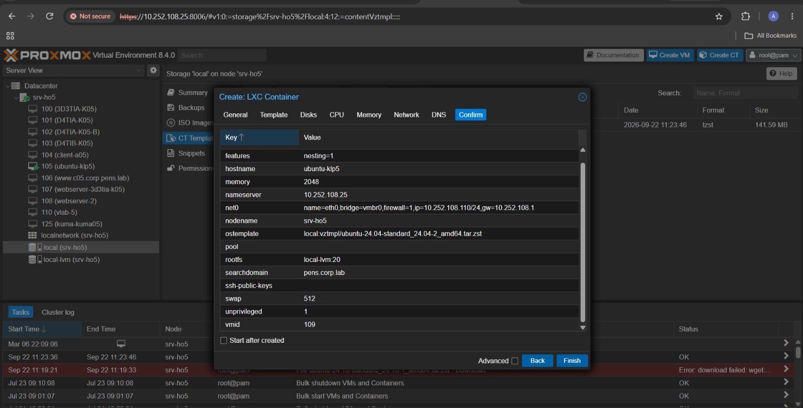

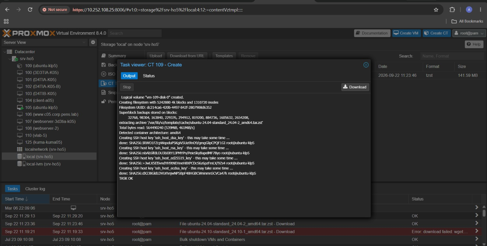

## SETTING NTP

Pada MikroTik, NTP digunakan untuk mengatur sinkronisasi waktu, sedangkan agar waktu tampil sebagai waktu Indonesia WIB, maka harus mengatur timezone menjadi Asia/Jakarta.

### Langkah 1: Setting Zona Waktu

WIB (Sumatra, Jawa, dan Kalimantan (Barat dan Tengah)

```bash
/system clock set time-zone-name=Asia/Jakarta
/system ntp client set enabled=yes
/system ntp client servers add address=time.google.com
/system ntp client servers add address=pool.ntp.org

```

### Langkah 2: Periksa Zona Waktu

```bash
/system clock print
/system ntp client print
/system ntp client servers print
```

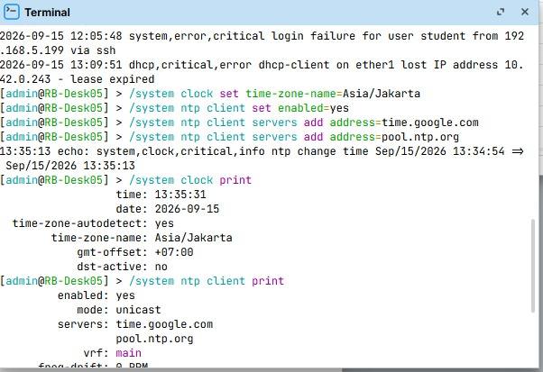

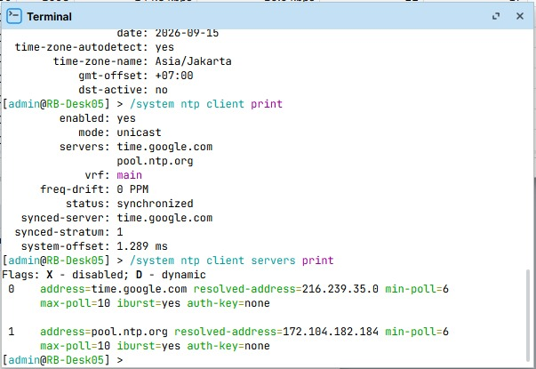

